# La confianza ya viene: Quiebres generacionales en la confianza institucional del Chile de los últimos 20 años

Gonzalo Bustamante Rojas y Alonso Quintero Contreras

editor del repo: [Gonzalo Bustamante Rojas](https://brojasgonzalo.github.io/)

## Resumen de la metodología

Análisis edad-período-cohorte de la confianza en cinco instituciones (Gobierno, Parlamento, Partidos, FF.AA. e Iglesia) con el panel armonizado de la Encuesta Bicentenario PUCV, 2006-2025.

- **Datos**: las encuestas 2006-2025 apiladas en una sola base, con ponderador. Nacidos entre 1930 y 2007, de 18 a 85 años.
- **Variable dependiente**: la confianza en cada institución, en escala 1-5, usada en tres formatos (ver *Variables*).
- **Modelo**: edad-período-cohorte jerárquico (HAPC). El año de encuesta (período) entra como efecto aleatorio; la edad (con término cuadrático) y la cohorte de nacimiento (en quinquenios), como efectos fijos. Controles: sexo, educación y NSE.
- **Tres esquemas generacionales**:
  1. Importado: Silenciosa / Boomer / X / Millennial / Z.
  2. Propio, histórico-local: Pre-masificación educativa / Estado desarrollista / Dictadura-transición / Democracia neoliberal / Generación del estallido.
  3. Corte único: un solo año de nacimiento, ligado a un hito político, divide la muestra en dos. Se probaron 1971 (plebiscito de 1988) y 1972 (retorno a la democracia en 1990).
- **¿Hay efecto de cohorte?** Test de Wald conjunto sobre los 13 coeficientes de cohorte.
- **¿Dónde está el quiebre?** Todas las fronteras de los tres esquemas se prueban igual, como corte binario: nacidos antes y nacidos desde ese año.
- **Contrastes**: el corte 1995 ola por ola, el corte movido año a año entre 1950 y 2000 y la curva de edad en cada período.

## General

Análisis edad-período-cohorte (APC) de la confianza institucional en Chile (Gobierno, Parlamento, Partidos, Fuerzas Armadas, Iglesia), usando el panel armonizado de la Encuesta Bicentenario PUCV (2006-2025). La pregunta central:

*¿Existe una ruptura generacional real en la confianza institucional chilena, distinta del efecto de la edad o de la coyuntura del momento (efecto de período), y si existe, dónde se ubica?*

Por lo tanto:

> **1. ¿Existe algún efecto de cohorte?**
>
> **2. ¿Dónde está exactamente el quiebre?**

*Variables*

La variable dependiente es la misma en todos los modelos: la confianza en cada institución, en una escala Likert de 1 a 5. Lo que cambia es el formato en que entra, y cada formato necesita su propio modelo:

| Formato | Cómo se codifica | Modelo multinivel |
|---|---|---|
| Ordinal (principal) | La escala completa, de 1 a 5 | Logit ordinal (`meologit`) |
| Binaria | 1 si confía (4 o 5), 0 si no (1 a 3) | Logit (`melogit`) |
| Continua | La escala estandarizada dentro de cada año (z-score) | Lineal (`mixed`) |

Si un resultado se repite en los tres formatos, no depende de cómo se codificó la confianza. Cuando se habla de "probabilidad de confiar", es la probabilidad de responder 4 o 5.

| Institución | N observaciones | Olas con datos | Años sin dato |
|---|---|---|---|
| Gobierno | 24.421 | 13 / 18 | 2007, 2008, 2009, 2013, 2014 |
| Parlamento | 28.292 | 15 / 18 | 2007, 2008, 2009 |
| Partidos | 26.306 | 14 / 18 | 2007, 2008, 2009, 2013 |
| FF.AA. | 26.354 | 14 / 18 | 2007, 2008, 2009, 2013 |
| Iglesia | 28.375 | 15 / 18 | 2007, 2008, 2009 |

<p align="center">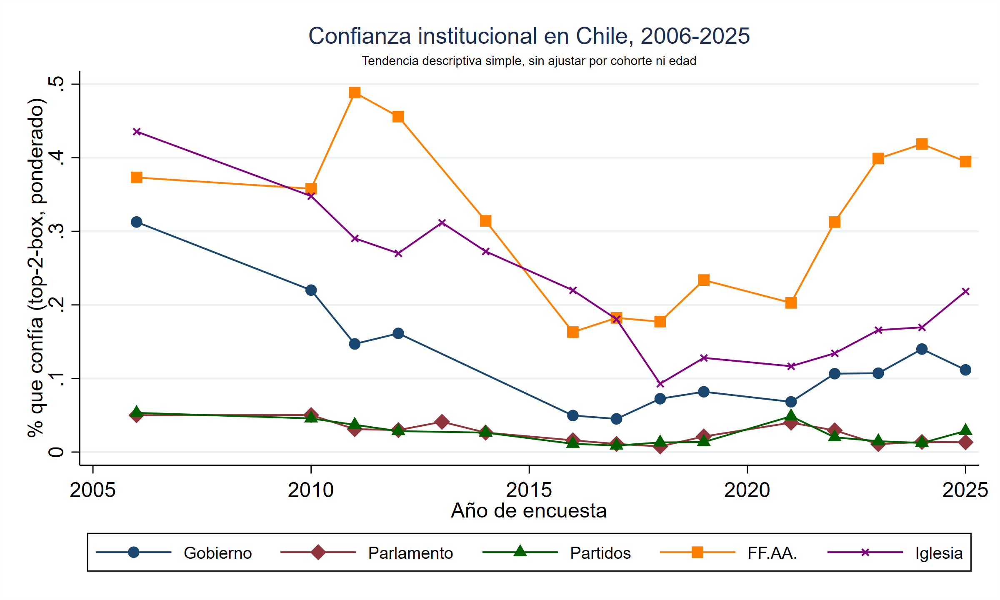</p>

*Modelado*

El análisis enfrenta el problema clásico de identificación edad-período-cohorte (Mason et al., 1973): como la cohorte es el período menos la edad, incluir las tres como variables categóricas en una misma regresión produce una dependencia lineal exacta. Durante años, el modelo lineal generalizado restringido (CGLIM) resolvió la indeterminación imponiendo una restricción de igualdad entre dos categorías, pero restricciones alternativas igualmente plausibles pueden llevar a conclusiones opuestas con los mismos datos (Mason et al., 1973). Aquí se usa el enfoque jerárquico edad-período-cohorte (HAPC) de Yang y Land (2006), en que el período es un efecto aleatorio de nivel 2. Así se estima un solo parámetro de varianza para las 18 olas, en vez de 18 coeficientes, y se resuelve la dependencia lineal sin restricciones arbitrarias. A diferencia del HAPC clásico, donde la cohorte también es aleatoria, aquí la cohorte se mantiene como efecto fijo (siguiendo a Bargsted y Maldonado, 2018), porque el objetivo es testear fronteras entre cohortes específicas y eso requiere un coeficiente por cohorte.

Los esquemas generacionales vienen de la literatura. La taxonomía importada es común en reportes chilenos (Didier, 2017; del Solar y Fernández, 2024), pero sus fronteras no tienen anclaje en la experiencia histórica local. La periodización propia se inspira en el argumento de Araujo y Martuccelli (2012) de que la subjetividad se forma en condiciones históricas concretas, extendido con la lógica de los "años impresionables" (Mannheim, 1928; Krosnick y Alwin, 1989). El corte único supone que un solo hito político separa a dos generaciones (Osborne, Sears y Valentino, 2011; Neundorf, 2017; Balcells y Villamil, 2026). Se probaron dos: el plebiscito de 1988, que los nacidos desde 1971 ya no alcanzaron a votar, y el retorno a la democracia en 1990, año en que cumplieron 18 los nacidos en 1972.

## Resultados

**1. ¿Existe un efecto de cohorte?**

Se aplicó un test de Wald conjunto sobre los 13 coeficientes de cohorte (H0: todos son cero a la vez). El test es significativo en las 15 combinaciones de institución y formato: hay un efecto de cohorte que localizar en las cinco instituciones.

| Formato | Institución | Wald χ² | gl | p |
|---|---|---|---|---|
| Binaria | Gobierno | 3255,56 | 12 | <0,0001 |
| Binaria | Parlamento | 42,24 | 13 | 0,0001 |
| Binaria | Partidos | 996,58 | 13 | <0,0001 |
| Binaria | FF.AA. | 74,65 | 13 | <0,0001 |
| Binaria | Iglesia | 504,92 | 13 | <0,0001 |
| Continua (z-score) | Gobierno | 1699,98 | 12 | <0,0001 |
| Continua (z-score) | Parlamento | 4593,56 | 13 | <0,0001 |
| Continua (z-score) | Partidos | 554,60 | 13 | <0,0001 |
| Continua (z-score) | FF.AA. | 207,31 | 13 | <0,0001 |
| Continua (z-score) | Iglesia | 71,50 | 13 | <0,0001 |
| Ordinal | Gobierno | 1300,63 | 12 | <0,0001 |
| Ordinal | Parlamento | 2421,13 | 13 | <0,0001 |
| Ordinal | Partidos | 53880,31 | 13 | <0,0001 |
| Ordinal | FF.AA. | 465,30 | 13 | <0,0001 |
| Ordinal | Iglesia | 966,55 | 13 | <0,0001 |

*Edad, período y cohorte en el HAPC*

Transversal a las instituciones aparece un patrón similar de cohorte: una caída o base baja entre las cohortes nacidas desde mediados de los 50 hasta comienzos de los 90, con un repunte en las cohortes más jóvenes (1995-99, generación del estallido). Gobierno es la institución con el patrón más claro: cae sostenidamente desde las cohortes más longevas y se recupera en el quinquenio 1995-99. Los efectos de período son bastante más planos, con una tendencia positiva sostenida en las cuatro instituciones donde tienen forma clara (Gobierno, FF.AA., Parlamento y Partidos suben de forma gradual entre 2006 y 2025, sin el hundimiento marcado de mediados de la década de 2010).

Para la edad, los coeficientes solo son significativos en Gobierno y Parlamento, pero vale la pena precisar la forma, no solo la significancia. En ambas el patrón es cóncavo: la confianza sube con la edad, pero a un ritmo decreciente; el salto de 18 a 40 años es proporcionalmente mayor que el de 60 a 80. Gobierno tiene el gradiente más pronunciado de las cinco instituciones, mientras que en Parlamento, aun siendo significativo, el rango es mucho más comprimido en términos absolutos (de 0,015 a 0,11 en probabilidad). FF.AA. es la única donde el perfil es visualmente plano y estadísticamente nulo.

<p align="center">
<a href="Principal/1b_continua_gob.png">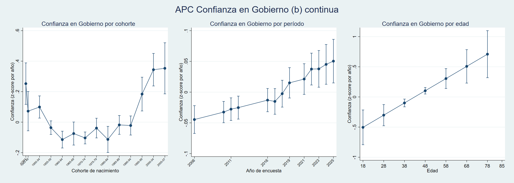</a>
<a href="Principal/1b_continua_ffaa.png">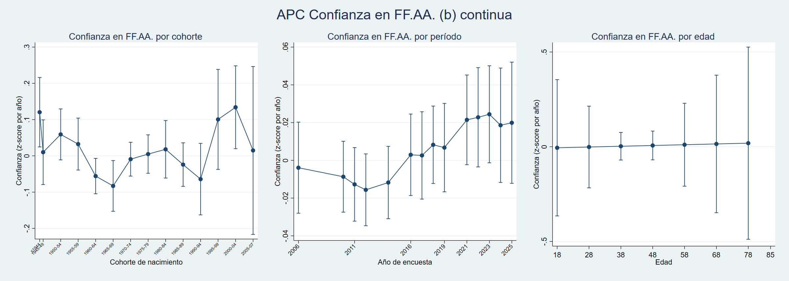</a>
<a href="Principal/1b_continua_igl.png">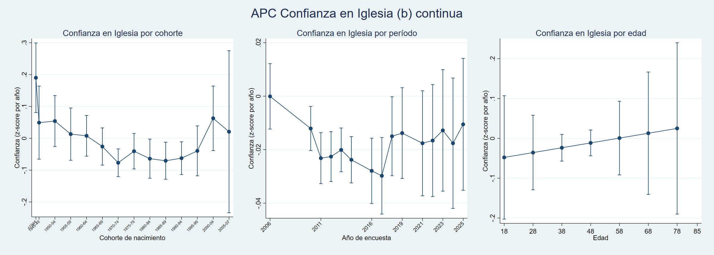</a>
<a href="Principal/1c_ordinal_parl.png">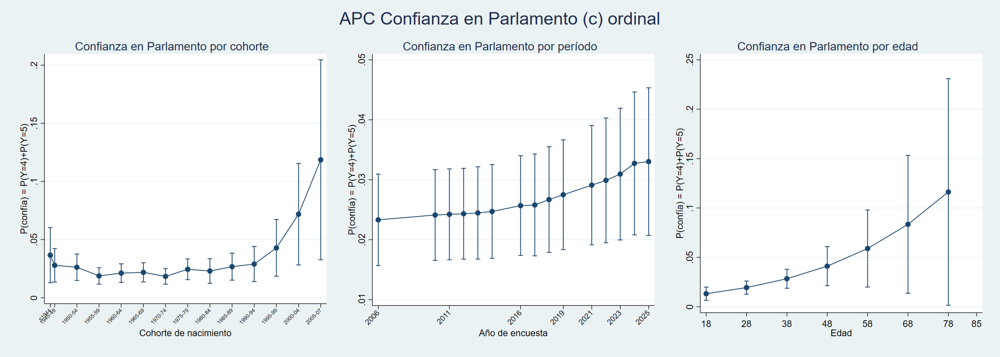</a>
<a href="Principal/1c_ordinal_part.png">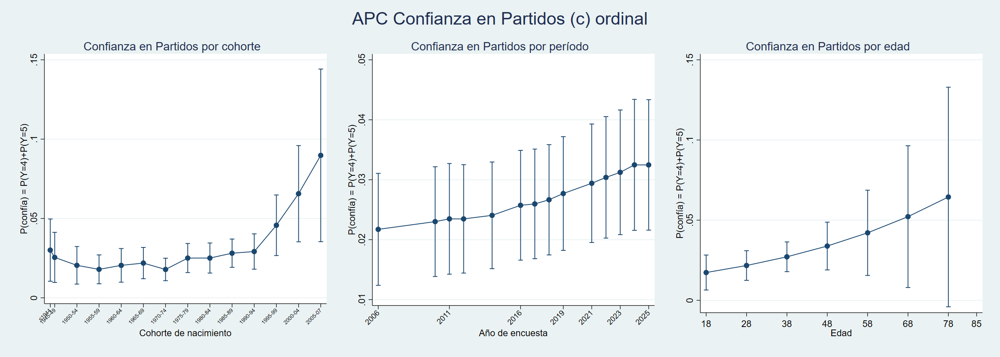</a>
</p>

<sub>Nota: se testeó la normalidad de los residuos individuales del modelo continuo (z-score) y de los 13-15 efectos aleatorios de período (uno por año encuestado). A nivel de período, la única institución con no-normalidad significativa es Iglesia, mientras que Parlamento y Partidos (las peores a nivel individual) salen normales. Es decir, en Parlamento y Partidos la no-normalidad está en cómo se distribuyen las personas dentro de un año, no en cómo varía el promedio de un año a otro; en Iglesia pasa lo contrario, muy probablemente por un año puntual que actúa como outlier (el escándalo de abusos de 2018 es el candidato más obvio).</sub>

**2. ¿Dónde está el quiebre?**

Todas las fronteras candidatas se prueban de la misma forma. Se divide la muestra entre nacidos antes y nacidos desde el año de la frontera, y esa variable reemplaza a los quinquenios en el HAPC ordinal. Lo que se grafica es la diferencia en la probabilidad de confiar entre ambos grupos, con la edad fija en el promedio. Cada corte se estima solo con las olas en que los nacidos desde ese año ya tienen 18 años (por ejemplo, desde 2013 para el corte 1995). Así los tres esquemas se comparan con el mismo diseño.

<p align="center">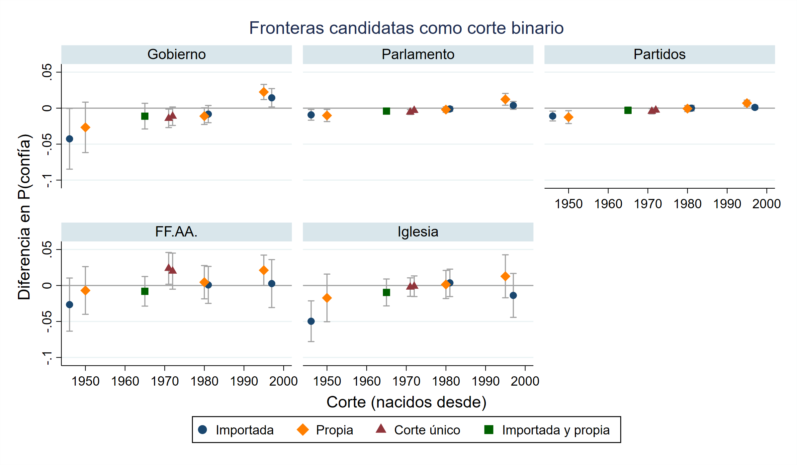</p>

Con las fronteras tempranas (1946 y 1950) la diferencia es negativa: las cohortes más antiguas confían más de lo que predice su edad. Con el corte 1946 es significativa en todas las instituciones salvo FF.AA. Entre 1965 y 1981 las diferencias son chicas, de menos de 1,5 puntos fuera de FF.AA. El corte 1995 es el único en que los nacidos después confían más, y la diferencia es significativa en cuatro instituciones: Gobierno (+2,2 puntos), FF.AA. (+2,1), Parlamento (+1,2) y Partidos (+0,7). En Iglesia es positiva pero no significativa (+1,3, p = 0,40). El corte 1997 (Millennial/Z) separa menos que el de 1995 en las cinco instituciones y solo es significativo en Gobierno.

En el corte único, el retorno a la democracia (1972) no es significativo en ninguna institución salvo Parlamento, y ahí apenas (p = 0,049). El plebiscito (1971) sí lo es en cuatro, pero en Gobierno, Parlamento y Partidos la diferencia es negativa y de tamaño parecido a la de los cortes vecinos (1965, 1972 y 1980): es el mismo gradiente de las cohortes antiguas, no un quiebre en 1971. La excepción es FF.AA.: los nacidos desde 1971 confían 2,4 puntos más (p = 0,035), una diferencia que deja de ser significativa con el corte 1972 y casi desaparece con el de 1980.

Un corte binario también recoge una tendencia gradual entre cohortes, así que la figura muestra dónde la separación es mayor, no si hay un salto brusco. Para eso están los tests de Wald entre quinquenios vecinos ([figura 5](Principal/5_forest_encrucijadas.png)).

*Magnitud de la brecha 1995*

La figura 7 muestra la probabilidad de confiar a cada lado del corte 1995 y la figura 10, la diferencia entre ambos con su propio intervalo. Las dos salen del mismo modelo de la figura 8. Los nacidos desde 1995 confían más en las cinco instituciones, con diferencia significativa en cuatro:

| Institución | Antes de 1995 | Desde 1995 | Diferencia (puntos) | p |
|---|---|---|---|---|
| Gobierno | 7,6% | 9,8% | +2,2 | <0,001 |
| FF.AA. | 26,5% | 28,6% | +2,1 | 0,049 |
| Parlamento | 1,8% | 3,1% | +1,2 | 0,004 |
| Partidos | 1,6% | 2,3% | +0,7 | 0,001 |
| Iglesia | 17,1% | 18,4% | +1,3 | 0,40 |

En puntos la brecha es chica. En Parlamento y Partidos se parte de una probabilidad muy baja, así que en términos relativos es más grande: los nacidos desde 1995 confían un 66% y un 43% más, respectivamente. En FF.AA. la diferencia es significativa por poco, y en Iglesia no se distingue de cero.

<p align="center">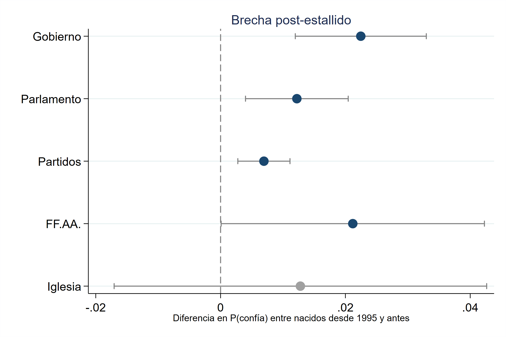</p>

<sub>Diferencia en P(confía) con la edad fija en el promedio, solo en las olas en que ya hay nacidos desde 1995 (desde 2013).</sub>

La figura 4 hace la misma comparación en el formato continuo (z-score).

<p align="center">
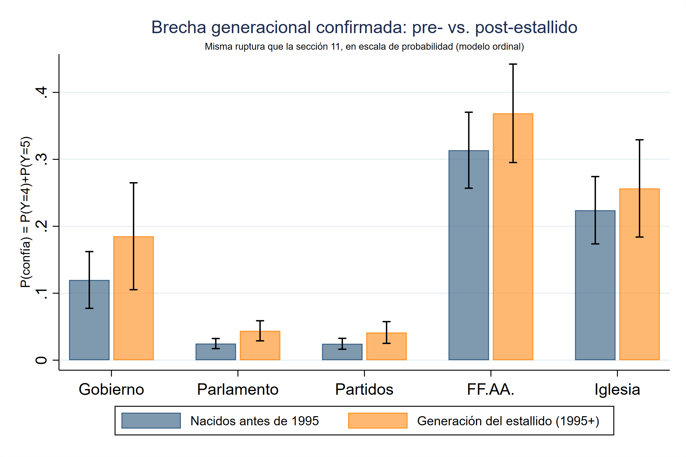
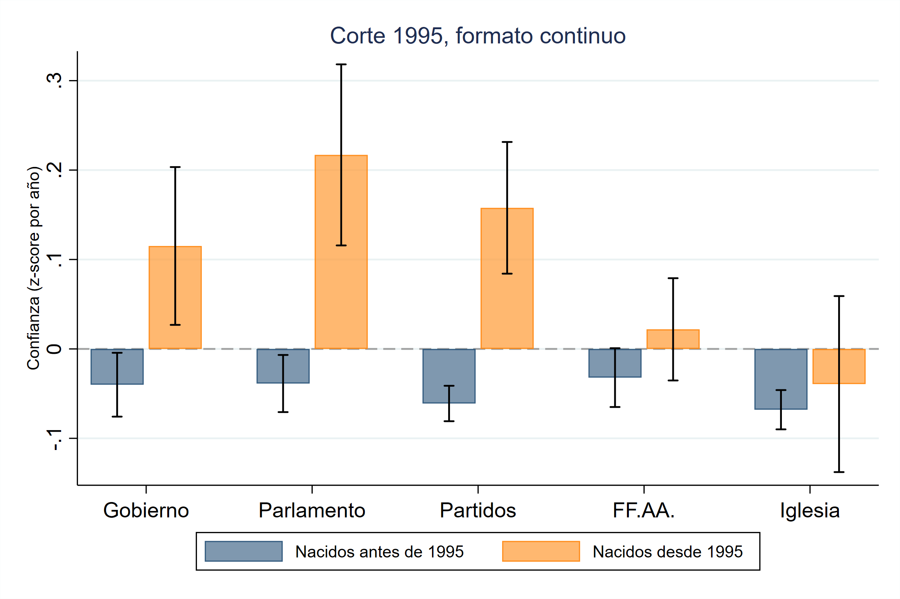
</p>

## Contrastes del corte 1995

Fuera del HAPC, se usó el diseño de Balcells y Villamil (2026): un logit con efectos fijos de año y logaritmo de la edad sobre el formato binario.

*Ola por ola*

El corte se cruza con el año de encuesta, lo que da una diferencia por ola, con la edad fija en el promedio. El corte 1995 solo puede estimarse desde 2013, cuando los nacidos desde 1995 empiezan a aparecer en la encuesta.

<p align="center">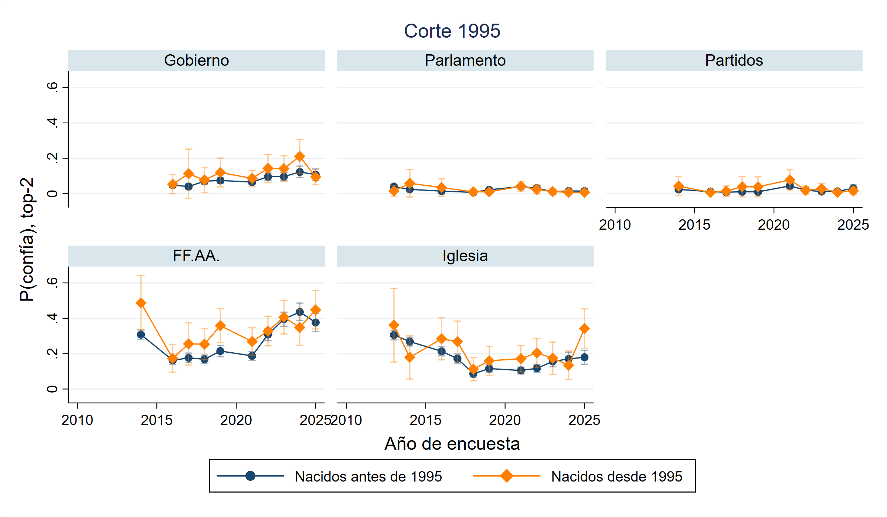</p>

La dirección es la misma que en el HAPC. En Gobierno, FF.AA. e Iglesia los nacidos desde 1995 confían más en casi todas las olas (8 de 9, 9 de 10 y 9 de 11), con diferencias promedio de 3,5, 5,9 y 4,6 puntos, más grandes que en el HAPC (figura 10). Ola por ola la diferencia casi nunca es significativa, porque cada ola tiene pocos cientos de casos de esa cohorte: solo lo es en FF.AA. (2014 y 2019) y en Iglesia (2022 y 2025). En Parlamento y Partidos no hay diferencia, porque casi nadie confía en ninguna cohorte. En 2017, ninguno de los 150 nacidos desde 1995 confía en el Parlamento, así que esa ola se excluye de su estimación.

Con el corte único de 1972, en cambio, no aparece diferencia en ninguna institución ([figura](Principal/11_corte1972_por_ano.png)): las dos líneas prácticamente se superponen durante todo el período, con diferencias promedio entre -2,5 y +0,4 puntos.

*Corte año a año*

Es la misma idea de la figura 8, pero con este logit, moviendo el corte año a año entre 1950 y 2000 y usando todas las olas en todos los cortes (sin cruzarlo con el año de encuesta).

<p align="center">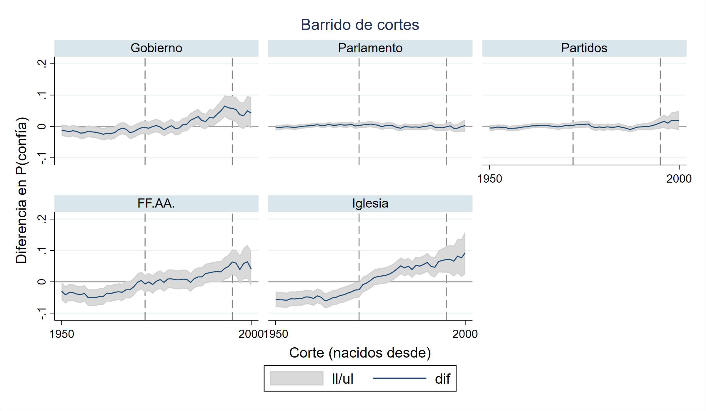</p>

En Gobierno la diferencia sube de forma gradual desde las cohortes de los sesenta, es significativa desde el corte en 1985 y llega a su máximo con el corte en 1993 (+6,5 puntos). Con el corte en 1995 es de +5,8 puntos (p = 0,004). En FF.AA. es negativa con los cortes tempranos, se mantiene cerca de cero entre los setenta y los ochenta y sube desde 1993, con máximo en 1999 (+6,4). Con el corte en 1995 es de +6,3 puntos (p = 0,002). En ambas el corte en 1972 da una diferencia nula. Iglesia tiene una pendiente continua: con los cortes tempranos la diferencia es negativa (las cohortes más antiguas confían más de lo que predice su edad), cruza el cero poco después de 1972 y sigue subiendo hasta el final, con diferencias significativas desde el corte en 1981. Hay un gradiente de cohorte, pero no un quiebre. Parlamento y Partidos quedan en torno a cero con cualquier corte.

El patrón es el mismo de la figura 8: las cohortes antiguas confían más, las diferencias son cercanas a cero en el medio y positivas a mediados de los noventa en Gobierno y FF.AA. Lo que cambia es el tamaño: con el corte 1995 la diferencia es de +5,8 y +6,3 puntos, contra +2,2 y +2,1 en el HAPC.

*Edad por período*

Un desplazamiento parejo de toda la curva de edad es efecto de período; uno concentrado en un tramo de edad apunta a cohorte. Se probaron tres formas de la edad: cuadrática ([figura 13](Principal/13_edad_por_periodo.png)), cúbica ([figura 13b](Principal/13b_edad_cubica.png)) y grupos de cinco años sin forma impuesta (figura 13c). El término cúbico no es significativo en ninguna de las 20 combinaciones de institución y período (p > 0,21 en todas), así que la cuadrática basta. Los grupos son la referencia, porque no imponen ninguna forma.

<p align="center">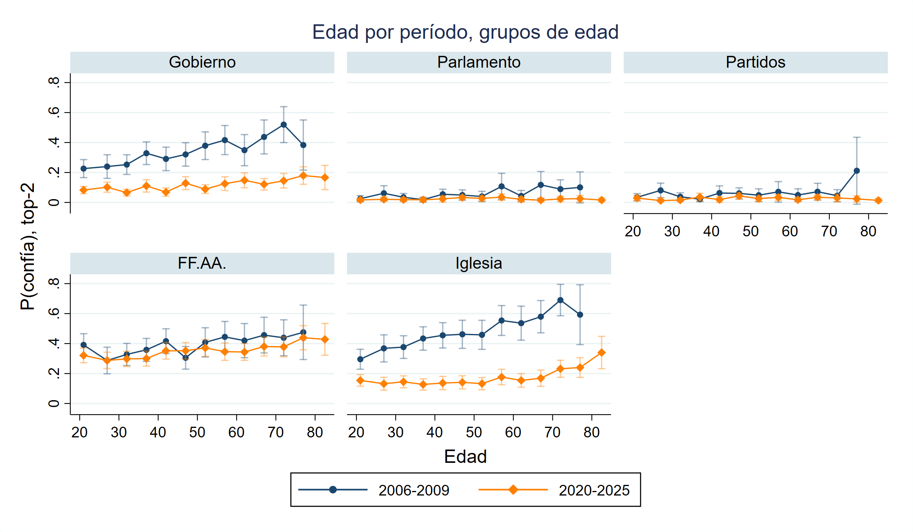</p>

Entre 2006-2009 y 2020-2025 la curva de edad se aplanó. En 2006-2009 la probabilidad de confiar en el Gobierno subía de 0,23 entre los 18 y 24 años a 0,52 entre los 70 y 74; en 2020-2025 se mueve entre 0,07 y 0,18 en todas las edades. En la Iglesia pasaba de 0,30 a 0,69; en 2020-2025 se mantiene entre 0,13 y 0,15 hasta cerca de los 55 años y recién después sube, hasta 0,34 entre los 80 y 85. En las dos instituciones, la caída entre períodos fue de 14 puntos entre los 18 y 24 años, y de 37 (Gobierno) y 46 puntos (Iglesia) entre los 70 y 74. En FF.AA. las dos curvas son casi iguales, y Parlamento y Partidos están en el piso en ambos períodos.

Dentro de un período, la edad y la cohorte no se pueden separar: los jóvenes de 2020-2025 son también las cohortes más recientes. Que en 2020-2025 los jóvenes no confíen menos que los de 30 a 55 años, cuando en 2006-2009 confiaban claramente menos, es lo que el HAPC registra como efecto de cohorte. También puede deberse a que para los menores de 55 años la edad haya dejado de importar en todas las cohortes, es decir, a una interacción entre edad y período. El HAPC asume una sola curva de edad para todos los períodos, así que atribuye ese aplanamiento a la cohorte.

## Otros hallazgos

El gradiente NSE es sistemático y significativo en las cinco instituciones: comparado con el grupo alto (categoría de referencia), el grupo bajo (D/E) tiene entre 30% y 40% menos probabilidad de confiar en Gobierno (OR=0,584), Parlamento (0,635) y Partidos (0,643), con FF.AA. algo más moderado (0,793) e Iglesia también significativo pero más débil (0,856). El gradiente es monotónico: a menor NSE, menor confianza, sin excepciones, y en magnitud es comparable o mayor que el salto generacional.

La educación superior se asocia a más confianza específicamente en las dos instituciones representativas, Parlamento (OR=1,275**) y Partidos (OR=1,412***), y no en Gobierno, FF.AA. o Iglesia, lo que es un poco contraintuitivo si se asume que más educación debería ir de la mano de más escepticismo hacia la política.

En FF.AA. las mujeres confían significativamente menos que los hombres (OR=0,849***), el efecto de género más fuerte de las cinco instituciones. En Iglesia el patrón se da vuelta por completo: las mujeres confían significativamente más (OR=1,135**). Partidos muestra el mismo signo que FF.AA., pero mucho más débil (OR=0,927*, apenas significativo), y en Gobierno (0,970) y Parlamento (0,978) el coeficiente no llega a ser significativo.

## Conclusiones

1. **Hay efecto de cohorte** en las cinco instituciones y en los tres formatos (Wald conjunto, p < 0,0001 en las 15 combinaciones).
2. **El quiebre está en 1994/1995, no en la transición.** Con todas las fronteras probadas igual (figura 8), el corte 1995 es el único en que los nacidos después confían más, con diferencia significativa en cuatro instituciones. Los cortes del plebiscito (1971) y del retorno a la democracia (1972) dan diferencias del mismo tamaño que los cortes vecinos, que reflejan un gradiente gradual entre cohortes y no un quiebre; la excepción es FF.AA. con el corte 1971. Ola por ola y moviendo el corte año a año, el corte 1972 no separa a nadie.
3. **Se mantiene que los nacidos desde 1995 confían más de lo que corresponde a su edad.** En el HAPC la brecha es positiva en las cinco instituciones y significativa en cuatro: Gobierno +2,2 puntos, FF.AA. +2,1, Parlamento +1,2 y Partidos +0,7. Con el logit ola por ola el signo se repite en casi todas las olas para Gobierno, FF.AA. e Iglesia, y el corte año a año ubica la mayor separación en torno a 1995 en Gobierno y FF.AA.
4. **La brecha es chica y se mide respecto de la edad.** El resultado no dice que los jóvenes confíen más que los adultos en términos brutos. En 2020-2025 confían parecido a los de 30 a 55 años y menos que los mayores. Lo que muestra es que ya no confían menos, como pasaba en 2006-2009 y como predeciría su edad. Ola por ola la diferencia es ruidosa y rara vez significativa, y su tamaño es comparable o menor que el del gradiente socioeconómico.
5. **Iglesia es el caso débil.** Su brecha 1995 es positiva pero no significativa, y tanto la figura 8 como el corte año a año muestran un gradiente continuo de cohorte (las cohortes antiguas confían más) más que un quiebre.
6. **Límites.** La cohorte 1995+ solo se observa entre los 18 y los 30 años, así que el tamaño de su brecha depende de cómo se modele la edad y de qué olas entren. En el HAPC, estimado solo con las olas desde 2013, la brecha en Gobierno y FF.AA. es de unos 2 puntos; con todas las olas (corte año a año) o con el logaritmo de la edad ola por ola, sube a entre 3,5 y 6,3 puntos. La edad cúbica no agrega nada en los perfiles por período, pero el HAPC asume una curva de edad común a todos los períodos. Si la curva se aplanó por un cambio de período que afecta a todas las cohortes, parte de lo que el modelo atribuye a la cohorte sería una interacción entre edad y período.

## Estructura del repositorio (mirror del Dropbox)

```
Análisis final/
├── README.md
├── dofile final confianza institucional.do     # script único: HAPC y contrastes
│
├── Principal/                                   # tablas y gráficos centrales
│   ├── tabla_1c_ordinal.rtf
│   ├── lr_bargsted_maldonado.csv                # test de Wald conjunto (resultado 1)
│   ├── tabla_4_wald_cohortes.csv                # tests de Wald dentro-bloque y de frontera por esquema
│   ├── 1b_continua_{gob,ffaa,igl}.png / 1c_ordinal_{parl,part}.png
│   ├── 4_brecha_estallido.png                   # corte 1995, formato continuo
│   ├── 5_forest_encrucijadas.png / 5_fronteras_quinquenales.csv
│   ├── 6_tendencia_temporal.png
│   ├── 7_brecha_estallido_prob.png / .csv       # corte 1995 en el HAPC, cada grupo con su IC
│   ├── 8_cortes_hapc.png / .csv                 # fronteras candidatas como corte binario (resultado 2)
│   ├── 9_wald_momento1_cohorte.png
│   ├── 10_forest_brecha_estallido.png / .csv    # diferencia del corte 1995 con su IC (sale de la figura 8)
│   ├── 11_corte{1972,1995}_por_ano.png / 11_corte_bv_por_ano.csv   # corte cruzado con año de encuesta
│   ├── 12_barrido_cortes.png / .csv             # corte movido año a año, 1950-2000
│   ├── 13_edad_por_periodo.png / .csv           # perfil de edad por período, cuadrática (el CSV trae las tres formas)
│   ├── 13b_edad_cubica.png / 13c_edad_grupos.png
│   └── cobertura_variables_detalle.csv / _resumen.csv
│
├── Auxiliar/                                    # robustez y diagnóstico
│   ├── tabla_1a_binaria.rtf / tabla_1b_continua.rtf
│   ├── tabla_2{a,b,c}_*_robustez_teorica.rtf
│   ├── tabla_3_diagnostico_normalidad.csv
│   ├── diagnostico_omitidas_cohort5.csv
│   └── 1a_binaria_*.png / 1b_continua_{parl,part}.png / 1c_ordinal_{gob,ffaa,igl}.png / 3_normalidad_*.png
│
├── Cohortes teóricas/                           # comparación descartada: cohort_teorica (5 bloques)
│   └── 1{b,c}_{continua,ordinal}_teo_*.png
│
└── Construcción del panel/
    └── build_panel_bicentenario_armonizado.do   # arma el panel 2006-2025 a partir de las bases anuales
```
